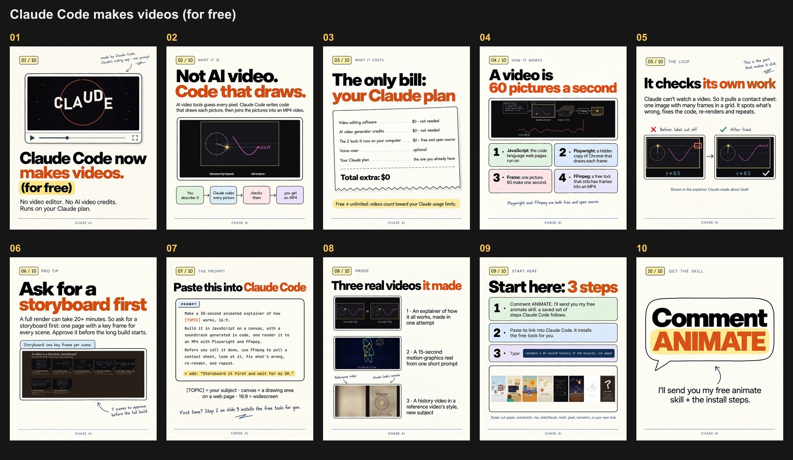
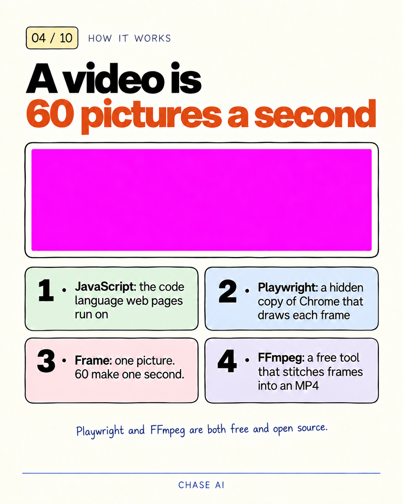
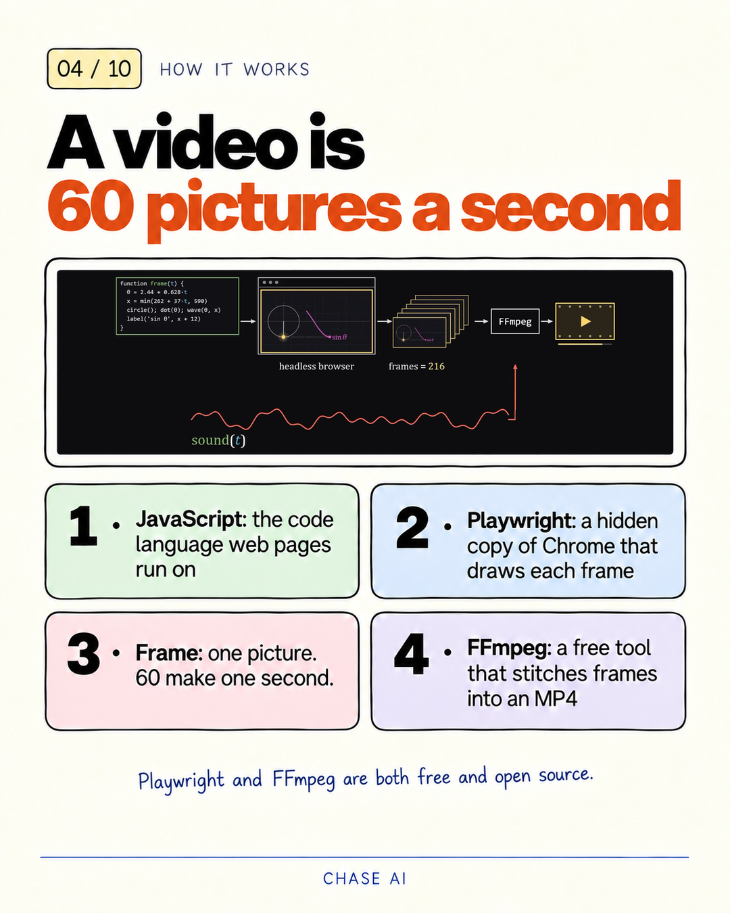

# Worked example: "Claude Code now makes videos. (for free)"

This is a real deck: Chase's Instagram carousel from 2026-10-14, and the first deck made with the
`/carousel` skill. It turns his YouTube video
[Claude Now Does Video (FOR FREE) Thanks To JavaScript](https://www.youtube.com/watch?v=rscb1DgJtNg)
into 10 slides. The comment keyword is **ANIMATE**, which delivers his free animate skill,
[github.com/cth9191/animate](https://github.com/cth9191/animate).

The CHASE AI branding on the slides is his. A deck of your own takes its footer from `engine/brand.json`.

| | |
|---|---|
| Topic | Claude Code makes videos with code (for free) |
| Source | YouTube `rscb1DgJtNg` + the public animate repo |
| Spine | A (cover → what → why → model → how ×2 → peak → use → start → CTA) |
| Style | **S11 Sketchnote Diagram Explainer** (image-native: Codex paints every slide) |
| Slides | 10, 1080 × 1350 |
| Keyword · deliverable | ANIMATE · the animate skill |
| Image worker | Codex `gpt-6.1-sol`, effort `high`, tier `priority` |

`brief-card.md` is the original touch-1 snapshot, with a few notes trimmed for this public copy. It
recommended S01 Terracotta Zine; Chase chose the alternative, S11. The Timing and Needs lines were sent
in chat, not written to the card, and the ten ranked hooks lived in `drafts/` (not included), so the card
shows the winner and two alternates.

## The deck



## Plate to final

Codex never draws the real thing. It paints a **plate**: the whole slide, every string verbatim, plus a
flat magenta keying zone where a real capture belongs. `shared/composite.py` finds the zone and fits the
capture into it.

| Plate: `plates/slide-04.v3.png` (1122 × 1402) | Final: `final/slide-04.png` (1080 × 1350) |
|---|---|
|  |  |

For slide 4 (`runs/composite/04.json`):

- **Zone.** One magenta zone, `M1`, at 947 × 283 px on the plate (aspect 3.35:1, fill 99.99%).
- **Asset.** `shots/s04-pipeline.png`, the pipeline diagram from the video at 1:32, with the webcam
  bubble scrubbed by `shared/shots.py`.
- **Fit.** `cover` fit around the shot's `focus` box, edge `matte`, `--dilate 3`, then a Lanczos resize to
  1080 × 1350. The report logs one warning: the focus box needed more than the whole shot at this aspect,
  so the fit padded the sides with the shot's edge colour. No leftover key pixels.
- **History.** This plate is the third version. QA v1 flagged the box order (Frame before Playwright), so
  `edit-slide-04` swapped the box text (`.v2`), and `edit-slide-04b` rewrote the handwritten note to name
  both tools (`.v3`).

`final/slide-04.png` is byte-identical to `exports/slide-04-2026-10-14.png`.

## How it was made

| Stage | What happened here |
|---|---|
| 0 · Intake | Captions and chapters pulled from the video, frames pulled at chosen timestamps, the animate repo's README and SKILL.md read. Written up as `dossier.md` with a verified-facts table (F1–F10). |
| 1–2 · Hooks and storyboard | Three writers drafted competing angles (outcome, mechanism, enemy), each with its own hooks scored on the R1–R6 rubric (max 12) and its own cold read. A judge panel picked the outcome draft and its hook (2 of 3 judges). The winner and three alternates live in `storyboard.json` (`hook`, `alt_hooks`), and it passed gates G1–G8. |
| 3 · Brief card (touch 1) | `node shared/brief-card.mjs carousels/2026-10-14-claude-video-free/storyboard.json --style S01 --alt S11` wrote `brief-card.md`. Approved, with S11 picked. To regenerate it now, add `--out <temp path>` (for example `--out /tmp/brief-card.md`) so the snapshot isn't overwritten. |
| 4 · Make | Shots built from the video, 11 prompts written, 2 cover variants generated (cover-b won and became the cover anchor), then 9 interiors. Claude's own plate check caught an invented margin note on slide 3 and duplicate number tags on slide 8, and two edits fixed them (`jobs-edits-1.json`). The slide 7 prompt was rendered as an exact-text HTML card, and every plate was composited. |
| 5 · QA and ship (touch 2) | An independent QA pass read every final slide (`runs/qa-v1.json`): 3 fails (slides 2, 4, 9) and 7 minor. Fixed with 3 more edits (`jobs-edits-2.json`, `jobs-edits-3.json`) and re-composites, the cold reader re-run, then exports, contact sheet and caption. |

## File map

| File | What it is | Stage | Made by |
|---|---|---|---|
| `dossier.md` | Source dossier: definition, pain, outcome, mechanism, setup, use cases, peak, objections, Chase's take, timing, glossary, verified facts | 0 | Claude, from `engine/templates/dossier.md` |
| `storyboard.json` | The record: hook, alt hooks, intent, glossary, every slide's `strings[]` and evidence, gates, cold-reader result, deviations, caption, sources | 1–2, updated in 5 | Claude, schema `engine/storyboard.schema.json` |
| `cold-reader.json` | The cold reader's last run, after the QA fixes: a different model reads only the slide text and recovers what / why / first step | 2, re-run in 5 | `shared/cold-reader.mjs` |
| `brief-card.md` | Touch 1, the original snapshot: hooks, storyboard table, spine test, gates, cold-reader table (first run), style pick, caption, logged deviations | 3 | `shared/brief-card.mjs` |
| `shots/shots.spec.json` | Which video frames and stills to cut, how to crop them and how to scrub the webcam bubble, per shot | 4 | Claude; built by `shared/shots.py` |
| `prompts/cover-a.txt`, `cover-b.txt` | The two cover plate prompts (cover-b changes only the composition) | 4 | Claude |
| `jobs-cover.json` | Codex job list for the two cover plates | 4 | Claude; run by `shared/codex-img.mjs gen` |
| `final/cover-anchor.png` | The locked cover plate (cover-b). Ref #1 of every interior job, so every slide matches the cover | 4 | Codex; copied from the cover-b plate |
| `prompts/slide-02.txt` … `slide-10.txt` | One plate prompt per interior slide, in the skill's prompt order | 4 | Claude |
| `jobs-interiors.json` | Codex job list for the 9 interior plates: model settings, concurrency, prompt, refs and output per plate | 4 | Claude; run by `shared/codex-img.mjs gen` |
| `cards/prompt-card.html` | Slide 7's prompt as an exact-text card, so the prompt is typeset, not painted | 4 | Claude; rendered by `shared/render-card.mjs` |
| `runs/plates-board.jpg` | Board of the first-pass plates (before edits), magenta zones still showing | 4 | `shared/codex-img.mjs board` |
| `plates/slide-04.v3.png` | Slide 4's plate after two edits (see above) | 4–5 | Codex |
| `runs/composite/04.json` | Slide 4's composite report: zone, asset, fit, warnings | 4–5 | `shared/composite.py --report` |
| `final/slide-04.png` | Slide 4 composited | 4–5 | `shared/composite.py` |
| `runs/qa-v1.json` | QA of all 10 finals: verdict, phone readability, notes, defects with fixes | 5 | Independent QA agents, merged by Claude |
| `prompts/edit-slide-*.txt` | Edit prompts: one change, then "keep everything else exactly as it is" (03, 08 from the plate check; 04, 04b, 09 from QA) | 4–5 | Claude |
| `jobs-edits-1.json` … `jobs-edits-3.json` | Edit jobs: the plate to change is ref #1, `out` is the same path (auto-versions) | 4–5 | Claude; run by `shared/codex-img.mjs gen` |
| `exports/slide-NN-2026-10-14.png` | The 10 shipped slides (slide 8's reference panel blurred, see below) | 5 | Copied from `final/` |
| `contact-sheet.jpg` | Touch 2: all 10 exports on one board | 5 | `shared/codex-img.mjs board` |
| `caption.md` | The post caption, from `storyboard.caption` | 5 | Claude |

## Left out, and why

- **Third-party style references** (`refs/`). The original run used two slides from another creator's
  carousel as layout references. They aren't ours to redistribute. `jobs-cover.json` and
  `jobs-interiors.json` now point at `engine/styles/exemplars/S11-interior.png` and `S11-cover.png`
  instead, which are this deck's own slide 4 and slide 1. The reference lines in the prompts (line 5 of
  the cover prompts, line 6 of `slide-02` … `slide-10`) were updated after the run to describe those
  exemplars, because the original third-party references aren't redistributed.
- **Slide 8's reference panel.** Slide 8's reference panel is another creator's video and is blurred in
  this copy; the posted slide shows it. The blur is in `exports/slide-08-2026-10-14.png` and in
  `contact-sheet.jpg` (slide 08, second row of the sheet; the blurred panel is the left half of that
  slide's third row).
- **Raw video frames** (the source video, frame sheets, hi-res stills, `drafts/frames/`, and the built
  `shots/*.png`). They're large and can be rebuilt from the public video with `shots.spec.json`.
- **Intermediate plates and composites.** The cover plates as generated (cover-b ships as
  `final/cover-anchor.png`), the other v1 and v2 plates, the other finals, `runs/zones/` and the other
  composite reports. Slide 4 is kept as the one plate-to-final example; `exports/` has every finished slide.
- **Codex logs** (`runs/runs.jsonl`, `runs/logs/`). Per-job event streams and stderr. They hold local paths
  and session ids. The numbers that matter are below.
- **Writer drafts and judge notes** (`drafts/`, including the ten ranked hooks), plus working boards
  (`style-pick.jpg`, `proof-frames.jpg`, `runs/deck-v1.jpg`, `deck-v2.jpg`, `edits-*.jpg`).

## Run stats

From the run log (not included):

| | |
|---|---|
| Codex jobs | **16 of 16 succeeded**: 2 covers, 9 interiors, 5 edits. No reruns. |
| Model | `gpt-6.1-sol`, effort `high`, tier `priority`, Codex CLI 0.162.1, read-only sandbox |
| Time per job | 29–57 s, about **46 s** average (first-pass plates 37–57 s, edits 29–40 s) |
| Tokens per job | 45–56K, about **50K** average (first-pass plates about 51–56K, edits about 45–50K) |
| Parallelism | Covers 2 at a time. Interiors: slide 2 alone first, then the other 8 at **4 in parallel** with a 2 s stagger, in about 2 minutes of wall time. Edits 2, 2 and 1. |
| Plate size | 1122 × 1402 (cover-a came back 1086 × 1448), composited down to 1080 × 1350 |
| Compositing | 0 leftover key pixels on all 10 slides |
| Cold reader | Reader 17 s + judge 10 s, about 21K tokens each, `gpt-6.1-sol` at effort `medium`. Verdict: pass. |
| Wall time | About 40 minutes from the first cover job to the last edit, including QA and all three edit rounds |

The lean worker setup (`--ignore-user-config --disable apps`) took about half the time and a third of the
tokens of an earlier test with a full user config.

## Re-running it

Paths below are from the repo root. Work in a copy of the deck folder, so the shipped files stay as
they are:

```
cp -r carousels/2026-10-14-claude-video-free carousels/2026-10-14-claude-video-rerun
D=carousels/2026-10-14-claude-video-rerun
```

In the copy, set `deck` in every `jobs-*.json` and `out_dir` in `shots/shots.spec.json` to
`carousels/2026-10-14-claude-video-rerun`. Keep the copy directly under `carousels/`: refs in a jobs file
resolve relative to its `deck` folder, which is why the exemplars are written as
`../../engine/styles/exemplars/…`.

1. **Source video.** Download a 1080p copy to the `video` path in `shots/shots.spec.json` (needs yt-dlp,
   and ffmpeg to merge the video and audio streams):
   ```
   yt-dlp -f "bv*[height=1080]+ba/b[height=1080]" --merge-output-format mp4 -o research/2026-10-14-claude-video-source/rscb1DgJtNg.mp4 https://www.youtube.com/watch?v=rscb1DgJtNg
   ```
   Then clone `github.com/cth9191/animate` next to this repo (the slide 9 tiles read
   `../animate/docs/styles.png`).
2. **Shots.** `python -I shared/shots.py $D/shots/shots.spec.json --sheet $D/runs/shots.jpg`. The spec's
   `bubble_prior` is the author's webcam position in this video (where the bubble to scrub sits); a video
   of your own needs its own.
3. **Cover.** `final/cover-anchor.png` is included, so the interiors can run without this step. To redo it:
   `node shared/codex-img.mjs gen $D/jobs-cover.json`, then copy the winning plate to
   `$D/final/cover-anchor.png`. The interior jobs use it as ref #1.
4. **Interiors.** `node shared/codex-img.mjs gen $D/jobs-interiors.json --only slide-02`, check it, then
   run the rest.
5. **Zones, cards, composite, QA, edits, export:** follow Stage 4 and Stage 5 of
   `.claude/skills/carousel/SKILL.md`. The edit jobs need first-pass plates that aren't shipped: each
   `jobs-edits-*.json` takes a plate from step 4 as ref #1 (and `jobs-edits-3.json` also needs the `.v2`
   plate that `jobs-edits-2.json` writes), so run them only after step 4.

Expect about 46 s and about 50K tokens per Codex job. Codex image output isn't deterministic and the style
references changed, so a re-run won't reproduce these pixels. The prompts, gates and compositing will
behave the same.
